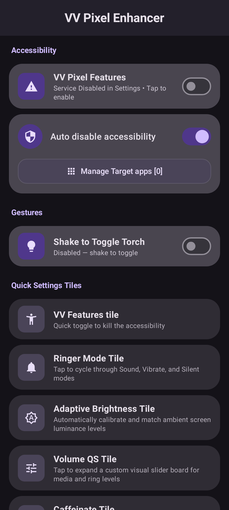
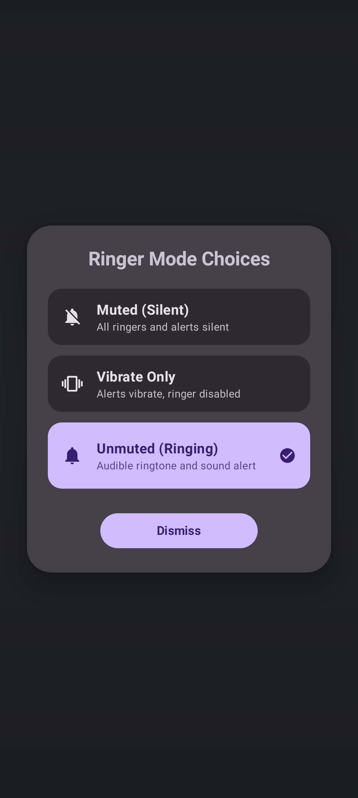
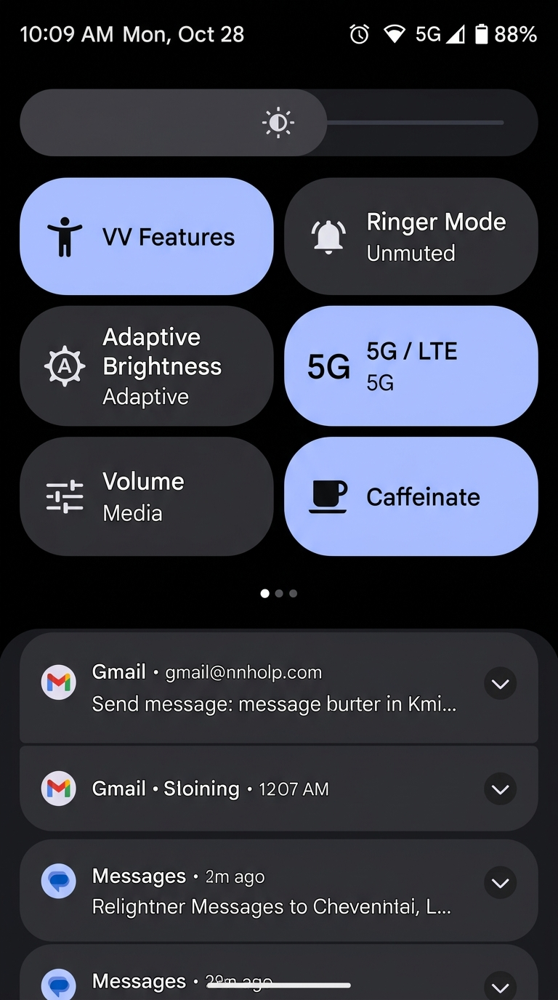
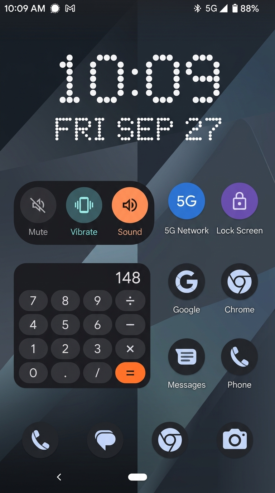

# VV Pixel Enhancer

**VV Pixel** is a native Kotlin & Jetpack Compose utility suite engineered specifically for Google Pixel devices (Pixel 10 / Android 14–16). It fills stock Android UX gaps—adding one-tap **5G / LTE** switching, biometric-safe **screen locking**, Motorola-style **shake-to-torch**, **Quick Settings** power tiles, **1×1 home screen shortcuts & Material You widgets**, **Doodle clocks**, and a **Hotspot Client Monitor**—with zero root required and Material 3 dynamic theming.

---

## Interface Screenshots

### App Dashboard & Translucent Overlays

| Main Dashboard | Quick Volume Overlay | Ringer Mode Choices |
| :---: | :---: | :---: |
|  |  |  |

### System Quick Settings Tiles & Home Screen Shortcuts / Widgets

| Quick Settings Panel | Home Screen Shortcuts & Widgets |
| :---: | :---: |
|  |  |

---

## Implemented Features

### 1. Accessibility & Safety Controls
* **Master Kill Switch (`VV Pixel Features`)**: Instantly enables or pauses all Accessibility-driven capabilities from the dashboard or the **VV Features** Quick Settings tile (`AccessibilityMasterState`, `AccessibilityMasterTileService`).
* **Auto-Disable on Sensitive Apps**: Monitors foreground window transitions (`TYPE_WINDOW_STATE_CHANGED`) and automatically calls `disableSelf()` when user-selected banking or sensitive apps are opened (`AppPickerBottomSheet`), preventing accessibility interference on protected screens.
* **Biometric-Safe Screen Lock**: Executes `AccessibilityService.GLOBAL_ACTION_LOCK_SCREEN` so Fingerprint and Face Unlock remain active after locking (avoiding legacy Device Admin PIN-lock restrictions).

### 2. Gestures (`ShakeTorchService` & `BootReceiver`)
* **Shake to Toggle Torch**: Runs an accelerometer listener inside a `specialUse` foreground service to toggle the rear camera flashlight via `CameraManager.setTorchMode` on rapid shake gestures.
* **Real-Time Force Vector & Threshold Slider**: Live accelerometer visualizer (`m/s²`) and customizable trigger sensitivity slider (`8.0 – 22.0 m/s²`) inside the app.
* **Persistent State Across Reboots**: Automatically restores Shake-to-Torch on `BOOT_COMPLETED`, `MY_PACKAGE_REPLACED`, and Accessibility Service reconnects.

### 3. Quick Settings (QS) Tiles
Six custom `TileService` integrations available in the Android Quick Settings editor:

| Tile | Service Class | Behavior & Implementation |
| :--- | :--- | :--- |
| **5G / LTE** | `NetworkModeTileService` | Collapses QS (`startActivityAndCollapse`), resolves the active mobile data SIM (`SubscriptionManager.getDefaultDataSubscriptionId()`), and arms the Accessibility auto-tap state machine (`NetworkToggleManager`) to flip `Preferred network type` between **5G** and **LTE** and return back automatically. Swaps dynamically between `5g` and `lte_mobiledata` icons. |
| **VV Features** | `AccessibilityMasterTileService` | One-tap master pause / disable toggle for `VVPixelAccessibilityService`. |
| **Ringer Mode** | `RingerModeTileService` | Cycles `Normal` → `Silent` (checks `NotificationManager.isNotificationPolicyAccessGranted`) → `Vibrate`, syncing with `RingerToggleWidget` and supporting `RingerModeDetailActivity`. |
| **Adaptive Brightness** | `AdaptiveBrightnessTileService` | Toggles `Settings.System.SCREEN_BRIGHTNESS_MODE` between `Adaptive` and `Manual` using `WRITE_SETTINGS`. |
| **Volume** | `VolumeTileService` | Uses a pre-warmed `PendingIntent` to launch `VolumeControlActivity`, a liquid-glass floating media volume slider synced bidirectionally with hardware volume keys. |
| **Caffeinate** | `CaffeinateTileService` | Temporarily extends `SCREEN_OFF_TIMEOUT` to 10 hours to keep the display awake, saving and restoring the user's original timeout when turned off. |

### 4. Home Screen Shortcuts & Material You Widgets
* **1×1 5G / LTE Toggle (`NetworkModeWidget` + Pinned Shortcut)**:
  * Occupies a **single 1×1 app-icon footprint** (`targetCellWidth="1"`, `targetCellHeight="1"`, `resizeMode="none"`).
  * Routes clicks through `NetworkModeToggleActivity` (a zero-history translucent trampoline) to comply with Android 14–16 Background Activity Launch (BAL) restrictions.
  * Automatically updates both the **1×1 Widget** and **Pinned Home Screen Shortcut** (`ShortcutManagerCompat.updateShortcuts`) in-place between **5G** and **LTE** icons after every toggle.
* **Double-Tap to Lock (`DoubleTapLockWidget`)**: 1×1 transparent invisible touch zone widget for empty home screen space; consecutive taps within `50–350ms` trigger a biometric-safe lock with configurable **Subtle Vibration Lock** intensity.
* **Lock Widget (`LockWidget2x1`)**: Dedicated Material You lock icon widget for one-tap locking.
* **Unmute / Mute / Vibrate Switcher (`RingerToggleWidget`)**: Responsive horizontal/vertical pill widget with active circle highlight synced in real time with `AudioManager.RINGER_MODE_CHANGED_ACTION`.
* **Pocket Calculator (`CalculatorWidget`)**: Interactive home screen calculator (`0–9`, `+`, `−`, `×`, `÷`, `C`, `⌫`, `=`) with expression and result state persisted in `SharedPreferences`.
* **Minimalist Doodle Clock Playground (`DoodleClockWidgets`)**: Four stylized clock & next-alarm widgets with Light/Dark in-app previews:
  1. **Cozy Sleepy Face** (`DoodleFaceClockWidget`)
  2. **Cute Blob Peek-a-boo** (`BlobMonsterClockWidget`)
  3. **Nothing LED Dot Grid** (`NothingPixelClockWidget`)
  4. **iOS Liquid Glass** (`LiquidGlassClockWidget`)

### 5. Hotspot Client Monitor (`MainActivity`)
* **Dynamic Interface & Subnet Discovery**: Inspects active network interfaces (`ap0`, `swlan0`, `wlan1`, etc.) to detect portable hotspot subnets automatically.
* **Concurrent Host Probing & Resolution**: Probes hosts `.1–.254` concurrently using coroutines, resolving hostnames via mDNS (`NsdManager`) / DNS PTR, ARP MAC addresses, manufacturer lookup, and round-trip latency (`ms`).
* **Custom Nicknames & Quick Copy**: Tap any client to copy its IP address or assign persistent custom nicknames saved in `SharedPreferences`.

---

## Permissions & Privacy

VV Pixel operates locally on-device with no cloud backend or telemetry:

| Permission | Purpose |
| :--- | :--- |
| `BIND_ACCESSIBILITY_SERVICE` | Biometric-safe screen locking (`GLOBAL_ACTION_LOCK_SCREEN`), double-tap lock, sensitive-app auto-disable, and 5G/LTE Settings auto-tap. |
| `WRITE_SETTINGS` | Adaptive Brightness and Caffeinate screen-timeout toggles. |
| `ACCESS_NOTIFICATION_POLICY` | Switching ringer mode into Silent/Mute without triggering DND exceptions. |
| `SYSTEM_ALERT_WINDOW` | Rendering floating translucent control overlays cleanly. |
| `FOREGROUND_SERVICE` / `FOREGROUND_SERVICE_SPECIAL_USE` | Keeping Shake-to-Torch accelerometer detection responsive in the background. |
| `VIBRATE` | Subtle haptic feedback on lock, ringer, and 5G/LTE actions. |
| `RECEIVE_BOOT_COMPLETED` | Restoring background gesture services after device reboot. |
| `ACCESS_NETWORK_STATE` / `ACCESS_WIFI_STATE` / `ACCESS_FINE_LOCATION` | Discovering local tethering interfaces and scanning connected hotspot clients. |

---

## Project Structure & Testing

* **Tech Stack**: Kotlin, Jetpack Compose (Material 3 Dynamic Color), Android AppWidgets (`RemoteViews`), `TileService`, `AccessibilityService`, `ShortcutManagerCompat`, Coroutines, Robolectric, and Roborazzi.
* **Compile & Unit Tests**:
  ```bash
  gradle :app:assembleDebug
  gradle :app:testDebugUnitTest
  ```
* **Update UI Screenshots**:
  ```bash
  gradle :app:recordRoborazziDebug --tests "com.example.ReadmeScreenshotTest"
  ```
